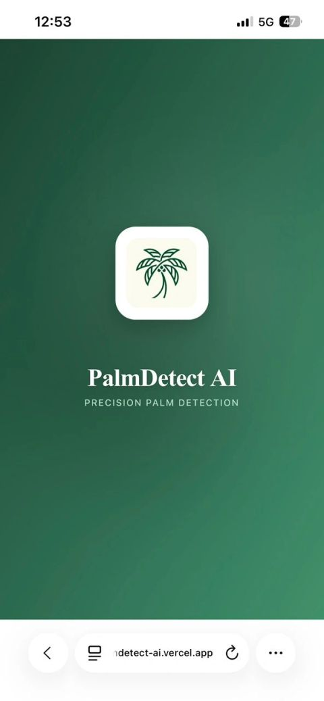
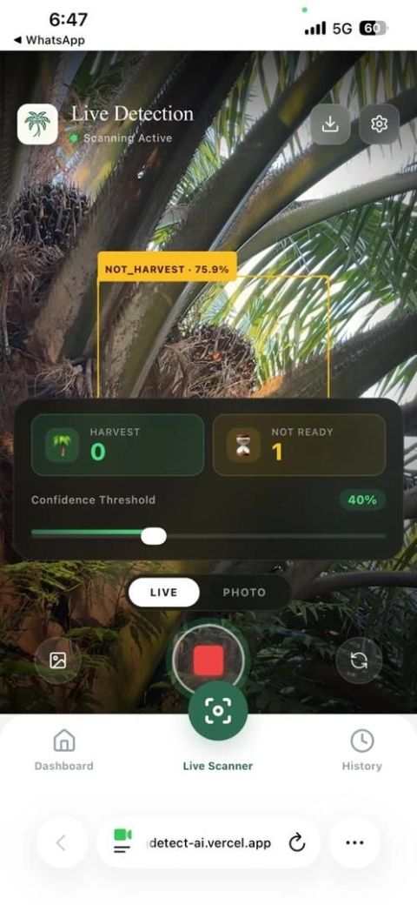
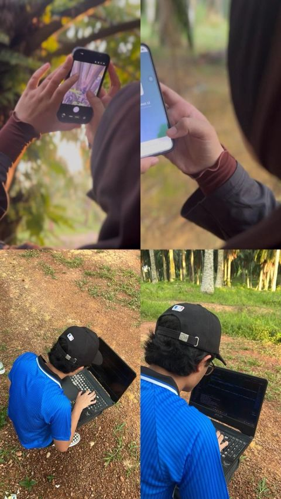

# PalmDetect AI

**AI-Assisted Learning for Oil Palm FFB Identification**

A web app that uses AI to identify whether oil palm fresh fruit bunches (FFB) are ready to harvest, helping learners and new workers recognise ripeness from a live camera view or a photo.

🔗 **Live demo:** https://www.palmdetectai.app/ *(the demo server is no longer running, see the screenshots below)*

🏅 **Achievements:**
- 🥈 Silver medal at [eCondev 2026 – eContent Development 2026](https://econdev.uitm.edu.my/)
- 🥉 Bronze medal at iNextTech 2026 (3rd International Next-Generation Innovation Technology Exposition 2026)

<p align="center">
  
</p>

---

## The Problem

Oil palm (sawit) is one of Malaysia's most important crops, and the quality of the oil depends heavily on harvesting fruit bunches at the right time. Harvest too early and the oil yield is low. Harvest too late and the fruit quality drops.

Knowing when a bunch is ready is a skill that people mostly learn through experience. Ripeness is judged by eye, so it takes time to learn, depends on who is teaching, and gives different results from person to person. New workers and students have few ways to practise and check their judgement on real bunches.

## Our Solution

PalmDetect AI lets a user scan a bunch with their phone camera, either live or from a photo. A YOLO object detection model labels each bunch as **HARVEST** or **NOT_HARVEST** and shows a confidence score, so learners get instant feedback and ripeness checks become more consistent.

## Screenshots

<table>
  <tr>
    <td align="center"><br><sub>Splash screen</sub></td>
    <td align="center"><br><sub>Live detection</sub></td>
  </tr>
</table>

### Field testing

<p align="center">
  
</p>

## Tech Stack

| Layer | Technology |
|-------|------------|
| Frontend | [e.g. React / Vue / plain JS] (`sawit-frontend`), deployed on Vercel |
| Backend | Python, FastAPI + Uvicorn (`sawit-backend`) |
| AI model | YOLO (object detection) |
| Dev tunnel | ngrok (exposes the local backend to the deployed frontend) |

## Project Structure

```
palmdetect-ai/
├── docs/images/      # Screenshots and photos used in this README
├── sawit-backend/    # FastAPI server and AI model inference
├── sawit-frontend/   # Web interface
└── README.md
```

## Getting Started

### Prerequisites

- Python 3.[x]+
- Node.js [version]+ and npm
- [ngrok](https://ngrok.com/) account (only needed to connect the deployed frontend to a local backend)

### 1. Run the backend

```bash
cd sawit-backend
python -m venv venv
venv\Scripts\activate          # Windows (macOS/Linux: source venv/bin/activate)
pip install -r requirements.txt
uvicorn main:app --reload
```

The API runs at `http://localhost:8000`. FastAPI docs are at `http://localhost:8000/docs`.

### 2. (Optional) Expose the backend with ngrok

Open a second terminal:

```bash
ngrok http 8000
```

Copy the generated `https://...ngrok...` URL and set it as the API URL in the frontend ([file or env variable name]).

### 3. Run the frontend

```bash
cd sawit-frontend
npm install
npm run dev
```

## Team

This project was built by a team of 4 and won **Silver** at eCondev 2026 and **Bronze** at iNextTech 2026.

| Member | Role |
|--------|------|
| Ahmad Emir Erfan bin Mohd Zubri ([@EmirErfan](https://github.com/EmirErfan)) | Developer |
| Zhamizah binti Zainal | Leader/Data Collector |
| Nurin Najihah binti Mohammad Najmuddin | Data Collector |
| Ahmad Nur Furqan bin Musa | Slide preparation |

## License

This project is licensed under the MIT License.
